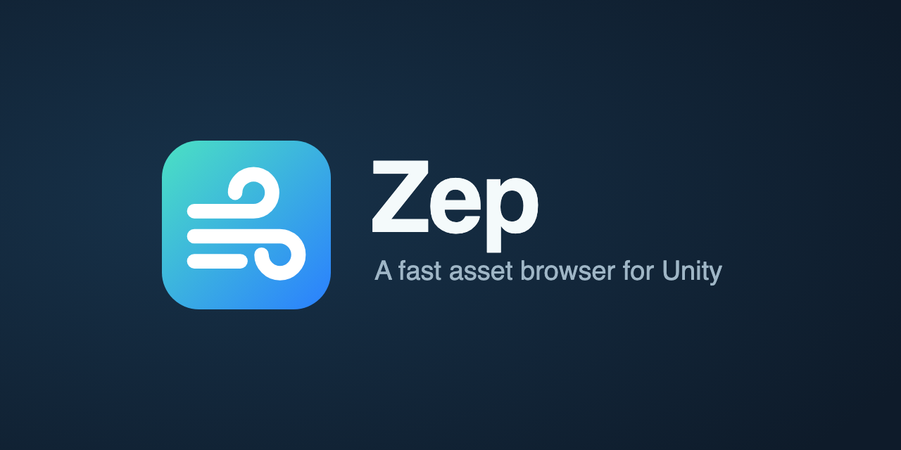

<p align="center">
  
</p>

# Zep

[](https://github.com/van-unity/zep/actions/workflows/core-tests.yml)
[](LICENSE.md)
[](https://unity.com/releases/editor/archive)

Zep is a fast asset browser for the Unity editor, built with UI Toolkit. The name comes from *zepyur* (զեփյուռ), Armenian for breeze. It provides fast browsing and search, a two-pane split view, folders and tags that dock as their own editor windows, list and grid views, tags, Quick Look previews, custom themes, and Unity Undo/Redo-aware file operations.

This is a pre-1.0 preview: behavior and the C# surface can still change between versions. Keep the project you use it in under source control, and please [report](https://github.com/van-unity/zep/issues) unexpected asset or metadata behavior.

## Requirements

- Unity 6.0 (6000.0) or newer.
- Git 2.14 or newer, installed and on your `PATH`. Unity uses it to download packages from a Git URL.
- Editor use only; the package assemblies are restricted to the Unity Editor and add nothing to player builds.

It is developed and exercised on macOS. Windows and Linux still need real-project smoke coverage; see [Verification status](#verification-status).

## Install

The package is installed straight from this repository. It has no dependencies on other packages.

### With the Package Manager

1. Open Unity's Package Manager window.
2. Click **+** and choose **Install package from git URL...**.
3. Enter this URL and confirm:

   ```text
   https://github.com/van-unity/zep.git
   ```

### By editing the manifest

Add the dependency to your project's `Packages/manifest.json` and return to Unity:

```json
{
  "dependencies": {
    "com.van-unity.zep": "https://github.com/van-unity/zep.git"
  }
}
```

### Choose a version

A plain URL installs the newest commit on `main`, the development branch. To stay on a fixed revision, append `#` and a release tag or a commit SHA:

```text
https://github.com/van-unity/zep.git#<tag-or-commit>
```

Tagged versions are listed on the [releases page](https://github.com/van-unity/zep/releases) as they are published, and [CHANGELOG.md](CHANGELOG.md) describes what changed.

### Update

Unity keeps a Git package on the commit it resolved at install time, recorded in `Packages/packages-lock.json`. To move to a newer commit, install the same URL again through the Package Manager. If you pinned a tag or commit, change the part after `#` in `Packages/manifest.json`.

### Remove

Choose **Tools > Zep > Remove Zep and all data...**. It lists what the package stored before anything is deleted and lets you cancel. Removing the package through the Package Manager works too and offers the same choice; [Data and safety](#data-and-safety) has the details.

## Open the panel

In Unity, choose **Window > Zep**. The panel can be docked like any other editor window.

Core workflows include:

- browse project assets, embedded packages, resolved packages, and tags;
- drag an Assets/Packages folder or tag into the workspace for one independent auxiliary split, with dedicated folder navigation and breadcrumb controls, then focus, replace, resize, or close it;
- drag any folder, favorite or tag out of the panel to dock it as its own Unity window: a tab, a split or a floating window that browses on its own and is restored after a script reload or a layout change;
- search by name, type, tag, GUID, or explicit path scope;
- switch between list and grid views and resize thumbnails;
- create, rename, duplicate, move, import, compress, and delete assets;
- undo and redo supported file operations through Unity's Undo history;
- press **Space** to open or close Quick Look for the current selection;
- create tags and themes from the Settings panel.

See [Documentation~/overview.md](Documentation~/overview.md) for the user-facing behavior and shortcuts.

## Search

Press **Shift twice** (the default shortcut) while Zep has focus, or click **Search** to open Quick Finder. Search stays independent of browser navigation and selection. Results show an asset icon or thumbnail, name, parent folder, and type. Every matching result is available in the virtualized list; name matches rank above matches in other metadata.

Use the common type buttons or **Types…** to narrow results, including a type-only search. Types opens a drawer from the right with searchable Common and Project type rows, checkmarks, a selected count, and Clear/Done controls. Selections apply immediately; Clear removes only type restrictions. Escape or the dimmed backdrop closes the drawer and returns focus to Types. Multiple types combine with OR. Typed qualifiers and clickable filters stay synchronized. Scope and inherited browser type/tag restrictions are visible; remove a chip or choose **Clear filters** without changing browser filters. A search with no matches offers filter removal and, where allowed, a broader scope.

**↑/↓** or a single click highlights a search result. **Double-click** closes Search and selects that asset in the main window. Folders are highlighted in their parent. Enter does not activate results. After selecting a result with **↑/↓** or a click, **Space** toggles the same Quick Look window used by the asset browser. Use **↑/↓** inside Quick Look to browse search results without changing the asset browser’s selection; closing it returns keyboard focus to the result. Space still types normally while editing the query. **Escape** closes the type picker or Quick Look first, then the finder; clicking outside both windows dismisses them. The opening shortcut (Double Shift or your configured binding) also closes Search, including its Quick Look. There is no Esc button. The query stays available when reopened. The empty field shows up to six recently activated queries, stored per user and project, with **Clear history** to remove them.

Plain terms are combined with AND. Repeated type filters (`t:` or `type:`) form one OR group, repeated Unity-label filters (`l:` or `label:`) form another OR group, and those groups are ANDed with each other and with plain terms. Unity labels are separate from Zep project tags, which use `tag:`.

Drag the bottom-right grip to resize Quick Finder, or drag its heading to move it. Results use the full available area at every size. Filters and keyboard hints stay reachable, and resizing keeps the selected result in view. Quick Look remains a separate, independently resizable window.

In **Settings → Shortcuts**, choose an available modifier/key combination and click **Use shortcut** to replace double-Shift. **Reset** restores double-Shift. The preference is saved per user, and only the selected shortcut opens Search. Choices exclude bindings used by Unity’s active shortcut profile or Zep. If a later Unity rebind creates a conflict, the custom shortcut stops firing and Settings identifies the conflict until you choose another binding or reset.

Common examples:

| Query | Behavior |
| --- | --- |
| `hero controller` | Both plain terms must match. |
| `t:prefab t:model` | Matches prefabs or models. Complete kind aliases are exact, so `t:script` does not also match `ScriptableObject`. |
| `t:EnemyConfig` | Matches a concrete custom type; real base types such as `t:ScriptableObject` also work. |
| `hero t:prefab t:model l:gameplay` | Matches `hero`, either type, and the Unity label. |
| `"player hud" -old` | Matches the quoted phrase and excludes `old`. |
| `!Bootstrap` | Matches the exact name. |
| `name=Bootstrap ext:cs a:assets` | Uses an exact name, C# extension, and Assets area. |
| `glob:"Assets/**/Editor/*.cs"` | Uses a project-relative glob; `**/` also matches zero folder levels. |

Supported fields and aliases are `n:`/`name:`, `path:`, `d:`/`dir:`/`directory:`, `t:`/`type:`, `l:`/`label:`, `tag:`, `e:`/`ext:`/`extension:`, `a:`/`area:` (`assets`, `packages`, or `all`), `guid:`/`id:`, and `glob:`. Prefix a value with `!`, or use `field=value`, for an exact match; prefix a term or field with `-` to exclude it. Common type kinds include `t:prefab`, `t:model`, `t:script`, `t:folder`, `t:file`, and `t:object`. Incomplete type text remains useful while typing (`t:pref`), while a complete kind alias matches that kind exactly. Unity labels and GUIDs apply to folders as well as files.

The visible scope controls further restrict results to All, Assets, Packages, or the current folder when those options apply. A rooted folder split always remains inside its root. This is a Unity Project-window-style grammar, not the full Unity Search QueryEngine: Boolean expressions, serialized-property comparisons, reference queries, and size queries are not supported.

## Performance

The panel keeps its own index of the project. On first open, the folder you are looking at is read directly from disk so it appears at once, while the full index loads in the background. After that, changing folders reads the index, and file operations update only the paths they touch instead of rescanning the project. **Refresh** forces a full resynchronization.

Measured on one machine (Apple M3 Pro, macOS, Unity `6000.3.10f1`):

| Measurement | Result |
| --- | --- |
| Opening the panel with a warm index | 25.4 ms at 2,200 assets, 30.6 ms at 22,000, 98.3 ms at about 127,800 (one run each) |
| Switching folders in a 128,753-asset project | 1.975 ms at the 95th percentile; Unity's own Project window measured 0.199 ms in the same project |
| Tenth keystroke of a narrow search on the stress project | 7.108 ms median, 10.177 ms maximum over five runs |
| Creating a folder or text file | no full rescan or view rebuild at any project size; Unity's own import time still applies |

These are engineering measurements from one machine, not latency guarantees. The method, raw numbers, gaps and caveats are in the [folder-navigation benchmark](Documentation~/FOLDER-NAVIGATION-PARITY.md), the [release verification record](Documentation~/PERFORMANCE-RELEASE-VERIFICATION.md), the [performance design specification](Documentation~/PERFORMANCE-REWRITE-SPEC.md) and the [search benchmark baseline](Tests/Editor/Core/Search/BENCHMARK_BASELINE.md).

## Data and safety

- Tag definitions and assignments are stored under the consuming project's `ProjectSettings` directory so teams can share them through source control.
- Undo/Redo retains exact asset contents and `.meta` files in a private temporary history cache under `Library/Zep/UndoPayloads`. It is local to the editor session and is not a backup.
- **Tools > Zep > Remove Zep and all data...** previews existing package data, paths, and cache file counts before requesting removal. **Cancel** leaves the package and its data intact. Cleanup starts only when Unity unregisters the package; updates preserve data.
- Removing the package through Package Manager or editing the manifest while Unity is open also shows the cleanup preview. **Delete all package data** deletes settings, tag definitions and assignments, favorites, Zep theme assets (including relocated ones), caches, saved preferences, session state, and the diagnostic log. **Keep data** skips cleanup but does not cancel Unity's package removal. Local themes, general preferences, and the diagnostic log are shared across Unity projects on the same computer; the preview identifies that scope. Normal assets created or imported through the panel remain.
- Cleanup reports paths it cannot delete and refuses symbolic links. Removing the dependency while Unity is closed cannot guarantee a popup or cleanup because the package code may be unavailable on the next launch. The dedicated removal action is unavailable for embedded packages and indirect dependencies, which Unity's removal API cannot remove directly.
- File commands preserve Unity `.meta` files and participate in Unity Undo/Redo where supported.
- Keep the consuming project under source control during this preview, especially when testing destructive operations or third-party asset-creation commands.

## Known preview limitations

- The supported product surface is the editor window. The currently public C# types are not a stable scripting API and may change before 1.0.
- Type-filter counts are project-wide even when the visible browser is scoped to one folder.
- In a very short docked panel, Tags controls can scroll above a deeply selected folder.
- A third-party `CreateAssetMenu` command does not tell Unity extensions which asset it created. Avoid running a concurrent automated import during the same editor tick as that fallback creation flow.
- Some features rely on Unity editor APIs that are internal, such as framing an Inspector ping on Unity 6.3+, docking a folder as its own window, fitting the search window to its monitor and creating a scene asset. They are version-gated or have a fallback, but a new Unity release can require a package update.

## Report a problem

[Open an issue](https://github.com/van-unity/zep/issues/new/choose) with the package commit SHA (from `Packages/packages-lock.json`), Unity version, operating system, exact steps, expected and actual behavior, and the relevant Console log or stack trace. If assets or `.meta` files were affected, say so first.

## Run the tests

The business logic in `Editor/Core` has no Unity dependency, so its tests run with the .NET 8 SDK alone:

```bash
dotnet test Build~/Core.Tests
```

Everything that needs the editor runs in Unity's Test Runner. To expose the package tests in a consuming project, add the package name to the root of `Packages/manifest.json`:

```json
{
  "testables": [
    "com.van-unity.zep"
  ]
}
```

Open **Window > General > Test Runner** and run the EditMode suite.

GitHub Actions runs the Core tests on every push and pull request. A second workflow runs the EditMode suite on Unity 6.0, 6.3 and 6.5 through GameCI; it needs Unity license secrets and skips itself where they are not available, such as pull requests from forks.

### Verification status

As of 2026-11-13, on macOS:

- **Core tests:** 513 pass on .NET 8.
- **EditMode suite:** on Unity `6000.3.10f1` in batch mode, 2,173 of 2,184 tests pass and none fail. Nine are skipped, and two inline-rename tests report as inconclusive because they need a focused editor window, which batch mode does not provide.
- **Other Unity versions:** the package sources compile against `6000.0.64f1`, `6000.3.10f1` and `6000.5.7f1`. The full EditMode suite has not been re-run on 6.0 and 6.5 for the current revision.

The CI matrix targets `6000.0.79f1`, `6000.3.19f1`, and `6000.5.7f1`. Windows and Linux still need real-project smoke coverage before this preview can be called cross-platform verified.

## Contributing

Bug reports, fixes and improvements are welcome. [CONTRIBUTING.md](CONTRIBUTING.md) covers the development setup, the two test suites and what a pull request needs. Everyone taking part is expected to follow the [Code of Conduct](CODE_OF_CONDUCT.md). To report a security problem, see [SECURITY.md](SECURITY.md).

## License

Zep is available under the [MIT License](LICENSE.md). Its icons come from [Phosphor Icons](https://phosphoricons.com), also MIT; see [Third Party Notices](Third%20Party%20Notices.md).
